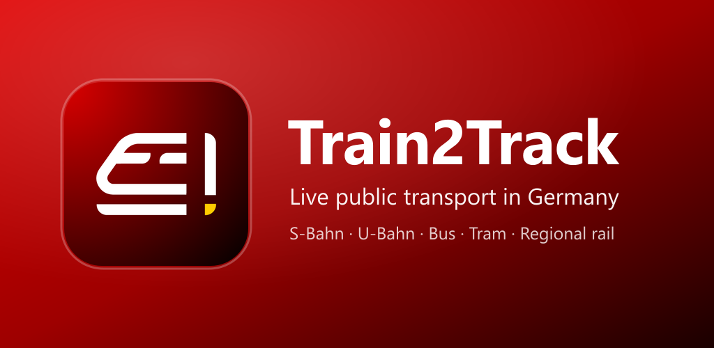
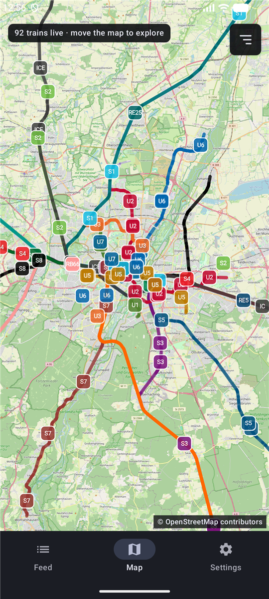
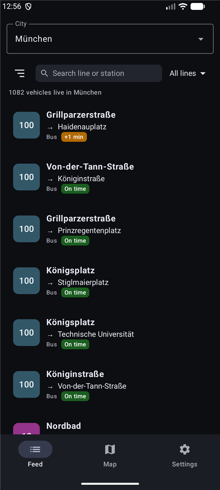
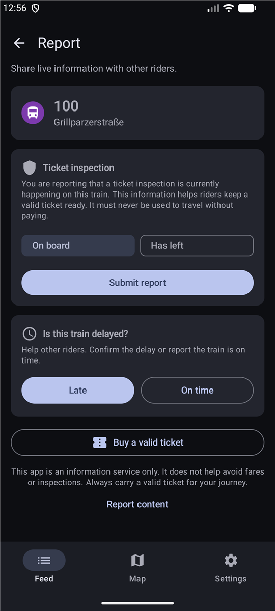
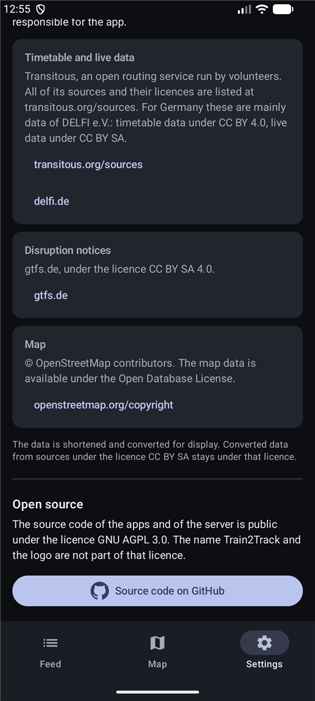
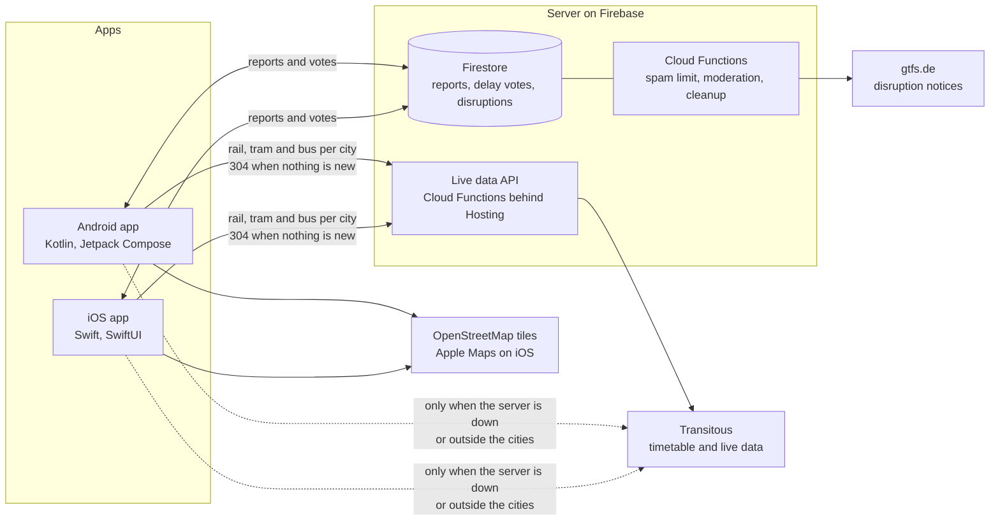

<p align="center">
  
</p>

<h3 align="center">Every S-Bahn, U-Bahn, tram and bus of nine German cities, moving live on your phone.</h3>

<p align="center">
  <a href="LICENSE"></a>
  
  
  
  <br>
  
  
  
  
</p>

<p align="center">
  <a href="https://train2track.de"><b>Website</b></a> ·
  <a href="#what-the-app-does"><b>Features</b></a> ·
  <a href="#how-it-works"><b>How it works</b></a> ·
  <a href="#privacy-by-design"><b>Privacy</b></a> ·
  <a href="#build-it-yourself"><b>Build it</b></a> ·
  <a href="https://github.com/John99101/Train2Track/issues/new/choose"><b>Report a bug</b></a>
</p>

# Train2Track

Train2Track shows public transport in nine German cities as it moves: S-Bahn, U-Bahn,
trams, buses and regional trains, on a map and as a list, with delays and disruption
notices. Riders can also tell each other that a ticket inspection is taking place on a
journey, as a reminder to keep a valid ticket ready.

The app is free, needs no account and works with a random identifier that does not say
who you are. This repository holds the source code of the Android app, the iOS app and
the server.

<p align="center">
  <b>9</b> cities &nbsp;·&nbsp; <b>5</b> kinds of transport &nbsp;·&nbsp; <b>20 s</b> between live updates &nbsp;·&nbsp; <b>0</b> accounts needed &nbsp;·&nbsp; <b>2</b> languages
</p>

<table align="center">
  <tr>
    <td align="center"><br><sub><b>Map</b>: every vehicle on its route</sub></td>
    <td align="center"><br><sub><b>Feed</b>: a whole city as a list</sub></td>
    <td align="center"><br><sub><b>Report</b>: inspection, delay, ticket</sub></td>
    <td align="center"><br><sub><b>Open</b>: data and code</sub></td>
  </tr>
</table>

## What the app does

| | |
|---|---|
| **Map** | Every vehicle in view moves along its route. Tap one to open it. |
| **Feed** | All lines of a city as a live list, with search and filters for S-Bahn, U-Bahn, tram, bus and rail. |
| **Delays** | Shown per journey where the data sources provide live data. Otherwise the journey is marked as scheduled. |
| **Disruptions** | Notices from open data, for the selected city. |
| **Reports** | "On board" marks a journey on which a ticket inspection is taking place. "Has left" ends it. Riders can also vote whether a journey is late. |
| **Ticket button** | Opens the ticket page of the local transport operator. |
| **Line colours** | Lines appear in the colours riders know from the network maps, where these are known. |
| **Look** | English and German, light and dark appearance. |

Cities: München, Berlin, Hamburg, Frankfurt, Nürnberg, Stuttgart, Köln, Düsseldorf and
Dortmund, each with its surrounding area.

Positions are calculated from timetable and live data. They show where a vehicle should
be, not a measured position.

> [!IMPORTANT]
> **The app is an information service.** It is not a tool for travelling without a
> ticket or for avoiding inspections. You always need a valid ticket.

## Status

Train2Track is in its final test on Google Play and TestFlight. The release in both
stores is planned for the end of October 2026. It is a one person project, built and run
in spare time.

## Privacy by design

What the code in this repository does, so that anyone can check it:

- **No account.** Each installation signs in anonymously and gets a random
  identifier. There is no name, mail address or phone number anywhere.
- **Reports do not show who sent them.** A report is stored under a name that is a
  hash of the identifier and the journey. It is different on every journey, so two
  reports of one rider cannot be linked by other apps. See
  [`functions/lib/reportIds.js`](functions/lib/reportIds.js) and
  [`firestore.rules`](firestore.rules).
- **Location stays on the phone.** It only preselects the city and shows your
  position on the map. It is never sent to the server.
- **Nothing optional without consent.** Usage statistics are off until switched on
  (Android only, iOS has none). At present the app shows no advertising. If it does
  later, no advertisement is requested before Google's consent dialog has been answered.
- **Delete my data.** One button erases everything on the server that belongs to the
  identifier, and the app continues with a new one. Identifiers that are not used for
  30 days are removed by the server.
- **Statistics without identifier.** The log of reported inspections holds line,
  station, journey, city and time only.

## How it works



- **Live data.** The server asks Transitous once per city and hands every app the same
  compact snapshot. The apps calculate each vehicle's position from the snapshot and the
  track shapes.
- **Line routes.** The server keeps the route of every line. It asks Transitous once
  per line, tops the set up once a week with lines it does not have yet, and fetches a
  missing line when an app first needs it. The apps never ask Transitous for a route.
  Long distance trains (ICE, IC, night trains) get no route line: they cross the whole
  country, and their position is enough.
- **Reports.** The apps write reports and delay votes straight to Firestore. The rules
  in `firestore.rules` decide what an app may write. Cloud Functions apply the spam
  limit and the moderation.
- **Disruptions.** A scheduled function reads the open feed of gtfs.de and stores the
  current notices, so that no phone has to download the whole feed.

### Light on data

A live map that refreshes every 20 seconds could easily eat a data plan. It does not:

- **Only what is shown.** The live data of a city comes in three parts: rail, tram and
  bus. The map loads only the kinds of transport it shows, the Feed only those in its
  filter.
- **"Nothing new" costs a few bytes.** Every answer carries a fingerprint (an ETag). If
  nothing has changed since the last refresh, the server answers `304 Not Modified`
  instead of sending the same data again. The live window moves in 60 second steps, so
  this happens often.
- **One question per city.** Firebase Hosting keeps each answer for 20 seconds, so
  Transitous is asked about once per city every 20 seconds, however many phones are
  open.

See [`functions/lib/liveApi.js`](functions/lib/liveApi.js) and
[`functions/lib/liveGroups.js`](functions/lib/liveGroups.js).

## Repository layout

| Path | What |
|---|---|
| `app/` | Android app (Kotlin, Jetpack Compose, osmdroid). Unit tests in `app/src/test`. |
| `ios/` | iOS app (SwiftUI, MapKit). `ios/MVVTrackerCore` is a Swift package with the shared logic and its tests. The project file is generated by XcodeGen from `ios/project.yml`. |
| `functions/` | Cloud Functions (Node.js): the live data API in `lib/liveApi.js` and `lib/transitous.js`, everything else in `index.js`. |
| `firestore.rules` | What an app may read and write. |
| `functions/test/` | Checks the live data, the rules and the functions, partly on the Firebase emulators. |

Android is the reference. iOS follows it and must behave the same.

## Data sources and credits

Train2Track only exists because of open data and open source software. Thank you.

| Source | Used for | Licence |
|---|---|---|
| [Transitous](https://transitous.org) | Timetable and live data. All of its sources are listed at [transitous.org/sources](https://transitous.org/sources/). | see the sources |
| [DELFI e.V.](https://www.delfi.de/) | German timetable data and live data, through Transitous | CC BY 4.0 and CC BY SA |
| [gtfs.de](https://gtfs.de/de/realtime/) | Disruption notices | CC BY SA 4.0 |
| [OpenStreetMap](https://www.openstreetmap.org/copyright) contributors | Map on Android | ODbL |
| Apple Maps | Map on iOS | terms of Apple |
| [MOTIS](https://github.com/motis-project/motis) | The routing software behind Transitous | MIT |
| [Träwelling line colours](https://github.com/Traewelling/line-colors) | Colours of lines where the timetable has none (`functions/lib/lineColors.json`) | CC0 1.0 |

The data is shortened and converted for display. Converted data from sources under a
share alike licence stays under that licence. The providers are not responsible for the
app.

Software used in the apps includes osmdroid, AndroidX and Jetpack Compose, Kotlin,
OkHttp, Retrofit and the Firebase and Google Mobile Ads software of Google. Each has
its own licence.

## Build it yourself

You can build and run your own version. It needs your own Firebase project: the live
Train2Track service is not part of this repository and may not be used by other apps.

**What is not in this repository, on purpose**

- Firebase config files (`google-services.json`, `GoogleService-Info.plist`), signing
  keys and every other credential.
- The legal notice and the privacy policy of the Train2Track service. The files in the
  apps are placeholders. If you publish a version, you are its operator and must write
  your own.
- The limits that protect the live service against misuse. `functions/lib/limits.js`
  holds example values.
- The list of app managers. `functions/lib/admins.js` is empty.
- The advertising ids. The build uses the public test ids of Google.
- The server address. The apps point to `example.invalid`.

<details>
<summary><b>Step by step</b></summary>

**Before you build**

1. Create a Firebase project with Authentication (anonymous sign in), Cloud Firestore,
   Cloud Functions, Hosting and App Check.
2. Copy `.firebaserc.example` to `.firebaserc` and enter your project id.
3. Replace `example.invalid` and `contact@example.invalid` with your own website and
   contact. Search for both: they are in `app/build.gradle.kts`,
   `app/.../util/AppInfo.kt`, `ios/MVVTracker/App/AppInfo.swift`,
   `ios/MVVTracker/Remote/LiveApiClient.swift` and `functions/lib/transitous.js`.
4. Give your version its own name, icon and application id (see [NOTICE.md](NOTICE.md)).
5. Read the [usage policy of Transitous](https://transitous.org/api/) and follow it.
   It asks, among other things, that every request names your app and a contact.

**Server**

```bash
cd functions && npm install && cd ..
firebase deploy --only firestore:rules,firestore:indexes,functions,hosting
```

**Android** (JDK 17, Android Studio)

Put your `google-services.json` into `app/`, then:

```bash
./gradlew :app:assembleDebug
```

**iOS** (Xcode, XcodeGen, iOS 16 or newer)

Put your `GoogleService-Info.plist` into `ios/MVVTracker/`, set your team in
`ios/project.yml`, then:

```bash
cd ios && xcodegen generate && open Train2Track.xcodeproj
```

</details>

## Tests

```bash
# Android unit tests
./gradlew :app:testDebugUnitTest

# Shared iOS logic
cd ios/MVVTrackerCore && swift test

# Live data in three parts, fingerprints and "nothing new" answers (no network needed)
node functions/test/live_groups.test.js

# How the server asks Transitous for line routes (no network needed)
node functions/test/routes.test.js

# Rules and functions on the Firebase emulators (needs Java 21 or newer)
firebase emulators:exec --only auth,firestore,functions --project demo-t2t "node functions/test/hidden_names.test.js && node functions/test/rules_more.test.js"

# Load test: 300 riders report while 300 apps read, on the emulators
firebase emulators:exec --only auth,firestore,functions --project demo-t2t "node functions/test/load.test.js"
```

## Contributing

Issues are welcome: bugs, wrong data, ideas.

Code is accepted only under strict rules. Read [CONTRIBUTING.md](CONTRIBUTING.md) before
you write any. In short: open an issue first, sign the contributor agreement
([CLA.md](CLA.md)), keep both apps in step, and never change what the apps collect or
send without agreement.

Found a security problem? Do not open an issue. See [SECURITY.md](SECURITY.md).

Everyone taking part is expected to follow the [code of conduct](CODE_OF_CONDUCT.md).

## Licence and name

Copyright (C) 2026 Jonathan Bonetti

The source code is free software under the
[GNU Affero General Public License, version 3](LICENSE). In short: you may use, study,
change and pass on the code. If you publish a changed app or run a changed server for
others, you must publish your source code under the same licence.

The name Train2Track and the logo are **not** part of that licence. A changed version
must use its own name and its own logo. [NOTICE.md](NOTICE.md) has the details and one
additional permission for the software of Google and Apple that the apps link to.

This repository is a published copy of the maintainer's working repository. It is
updated in single commits, so the history here is short.

## Disclaimer

Train2Track is independent. It is not operated by, sponsored by or affiliated with any
transport operator, transport association or public authority. Names of operators and
lines belong to their owners and are used only to describe the service concerned.

The software comes without any warranty. Positions, delays, disruptions and reports can
be late, incomplete or wrong.

<p align="center"><sub>Built on open data and open source software.</sub></p>
